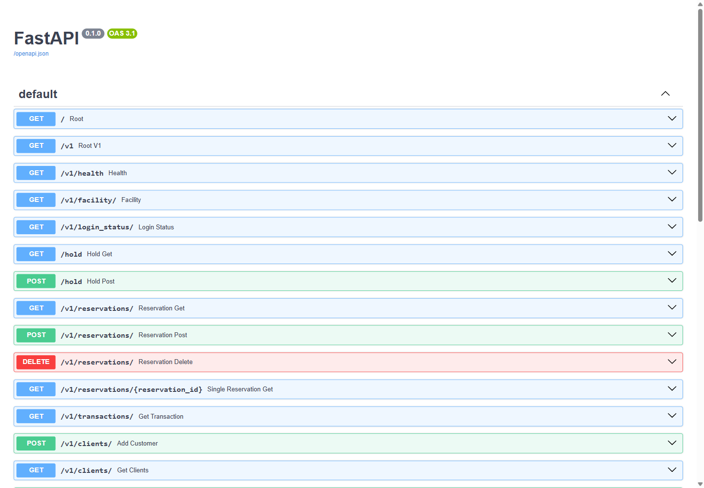
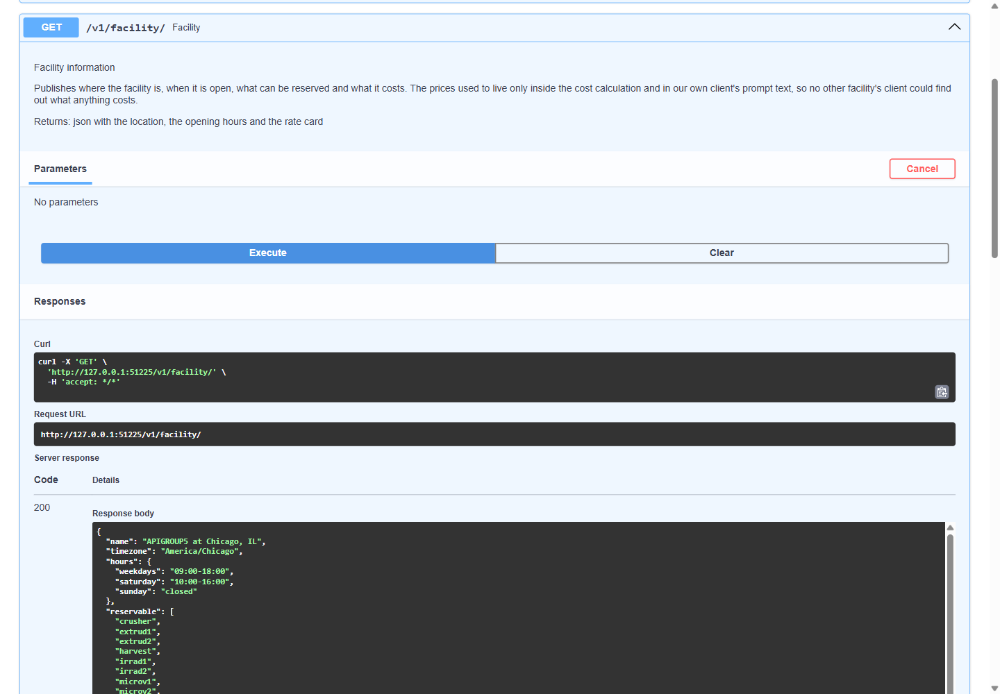
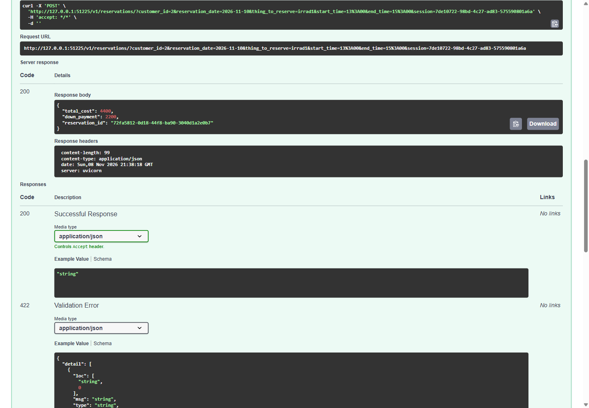
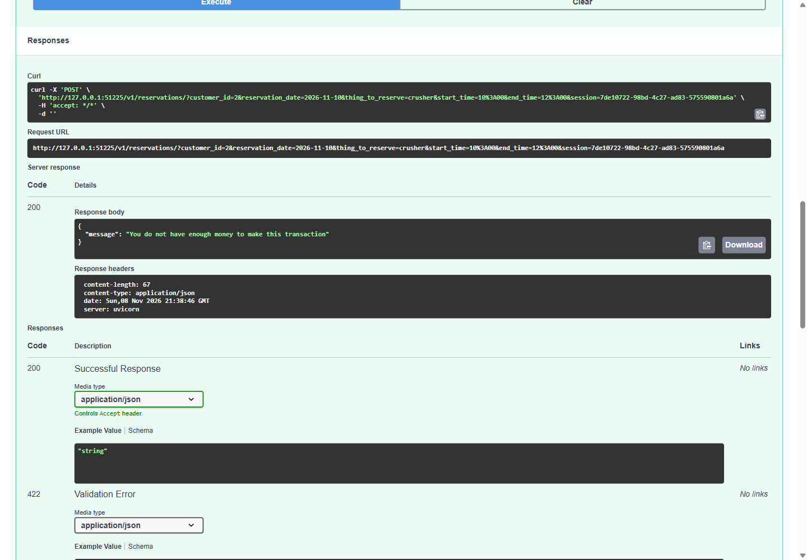
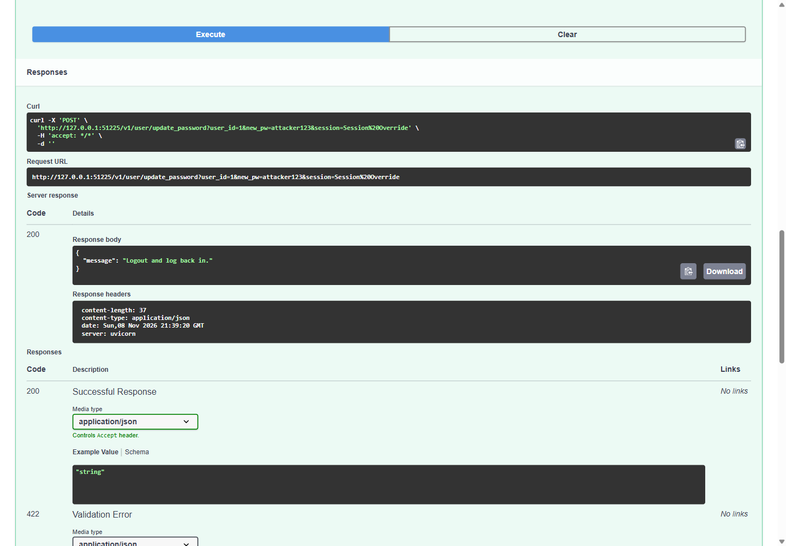

# Distributed Facility Reservation System

A booking system for a shared equipment facility, built as a FastAPI service over
SQLite with a persistent command line client. It was written to interoperate with four
other teams' independent implementations of one shared HTTP contract that nobody could
change on their own, so a booking that cannot be filled locally is offered to the other
facilities before the customer is turned away.

The service exposes 30 endpoints, 27 of them under `/v1`, with OpenAPI documentation
generated at `/docs`. The test suite is 71 pytest tests across the API, the database
and the reservation rules.

## Demo

Everything below is the system running locally, first through the generated API
documentation and then through the console client.

### The API

The service documents itself. Each screenshot is the running server, driven through
its own Swagger UI at `http://localhost:51225/docs`.



`GET /v1/facility/` publishes the opening hours and the rate card, so any client can
discover what the facility charges without hardcoding a price list. The rates it
returns are the same constants the cost calculation uses.



`POST /v1/reservations/` books a slot. Two hours of `irrad1` costs 4,400 against the
published rate of 2,200 an hour, with half of it taken as the down payment, so the
rate card and the billing agree.



The same endpoint refuses a booking the customer cannot afford. A crusher runs at
20,000 an hour and this customer holds under 10,000, so the reservation is undone
before the call returns. The rule lives in the endpoint, which means it holds for the
peer facilities' clients as well as our own.



Every endpoint needs a real session. A password change is no exception, so a request
that carries anything other than a live session is turned away before it reaches the
database.



### The command line client

### A manager registers and creates a customer

```text
1: facility manager, 2: client, 3: quit
-> 1

=====Facility Manager Access=====
Do you have account? yes or no:
no
What is your name? Tan Dai Ngo
New username: peter
New password: peter
Registration success! Hello peter!

What would you like to do?
(1  = Activate client login
 2  = Deactivate client login
 3  = List all clients
 4  = Find client account
 5  = Create new customer
 6  = Edit customer account
 7  = Activate client
 8  = Deactivate client
 9  = Get all reservations
 10 = Get client reservation report
 11 = Edit a Reservation
 12 = Cancel a Reservation
 13 = Get transaction reports
 14 = Manager Dashboard
 logout = logout)
 -> 5
Add a customer
========================================
What is the customer name? Alice Chen
The customer ID is: 2

 -> 3
Name: Alice Chen, User_id: Alice Chen, Active: 1, Funds: 10000.0
Do you want to save as csv? [1] yes [2] no -> 2
You chose not to save the csv file

 -> 14
Manager Dashboard

====================
Client login: enabled
Environment: prod
Active Sessions: 1
====================
```

### The customer signs in and books a slot

```text
1: facility manager, 2: client, 3: quit
-> 2
==========Client Access==========
Do you have account? yes or no: yes
If this is your first time signing in, your password is the same as your name.

id: Alice Chen
password: Alice Chen
Login success! Hello Alice Chen

What would you like to do?
(1 = Make a reservation
 2 = Edit a reservation
 3 = Cancel a reservation
 4 = List my reservations
 5 = Show my account balance
 6 = Add funds to my account
 7 = List my transactions
 8 = Edit my profile
 logout = logout)
 -> 5
Show My Account Balance
========================================
Account Balance Below
user: 2
account balance: 10000.0

 -> 1
Make a Reservation
========================================
What do you want to reserve?
(options:
        microv1(2,000/hr),
        microv2(2,000/hr),
        irrad1(2,200/hr),
        irrad2(2,200/hr),
        extrud1(500/hr),
        extrud2(500/hr),
        crusher(20,000/hr),
        harvest(8,800/hr),
        workshop1(99/hr),
        workshop2(99/hr),
        workshop3(99/hr),
        workshop4(99/hr))
-> workshop1

What date do you want to do your reservation? (yyyy-mm-dd, Our facility does not support recurring reservations.)
 -->2026-11-09
What time do you want to start the reservation? (HH:MM)
 --> 10:00
What time do you want to end the reservation? (HH:MM, inclusive; min. 1 hour; please enter a time range within normal business hours)
 --> 12:00

Reservation success
========================================
Reservation Info
reservation id: 50c6146a-9c3b-40f3-bdce-ebf6b619b87e
total cost: 198.0
========================================
Your new account balance
user: 2
account balance: 9802.0
```

Two hours of `workshop1` at 99 an hour costs 198, and the balance drops from 10,000 to
9,802 in the same step that creates the booking.

## How to run the program

Install the requirements:

```bash
pip install -r requirements.txt
```

Start the server:

```bash
uvicorn main:app --reload --host 0.0.0.0 --port 51225
```

Then start the client in another terminal:

```bash
python client.py
```

The client talks to `http://localhost:51225` by default. This project was originally
deployed to a University of Chicago course server, which no longer runs, so the remote
address in `client.py` is left commented out.

The first account has to be a manager, because client logins are off until a manager
turns them on. Choose `1`, answer `no` when asked whether you have an account, and
register. Interactive API documentation is at `http://localhost:51225/docs`.

## How to run the tests

Navigate to the root directory, and then type:

**Running all tests**

```bash
pytest
```

**Running specific tests**

```bash
pytest tests/test_database.py
pytest tests/test_main.py
pytest tests/test_reservation.py
```

## Program description

### Our facility

Our facility is located in the beautiful city of Chicago, IL. We operate in Central
Time and are open from 9am to 6pm on weekdays and from 10am to 4pm on Saturdays. We are
closed on Sundays.

### Program overview

Our main program is a persistent command line program that allows facility managers and
clients to access a dashboard, filled with options of what they can do within our
facility. Facility managers have different options than clients, and client logins need
to be enabled (at least once) by a facility manager. After client login is enabled,
client users can access the program directly and choose from a wide variety of options.

When you start the program, it will pull the current status of the client login
feature. If it had been set previously, then you won't need to log in as a facility
manager to enable it. If it had not been set previously, then the user will need to log
in first as a facility manager.

Users cannot make reservations in the past, or make reservations for days where the
thing to reserve is already reserved. Users also cannot make reservations for which
they do not have the funds to cover the total cost of the reservation, even if their
funds are enough to pay for the down payment.

If the reservation requested is invalid, the user will see that information and can
then make a different request.

### Making a reservation (interoperability)

When a user makes a reservation, it will first check our local facility to see if this
machine is available at this time. If it is not, but the reservation is otherwise
valid, the program will randomly shuffle through the other four locations and try to
make the reservation with their machine at the specified time. The program will
randomly shuffle through until it finds an open machine, or until it has gone through
all four other locations.

If none of the locations have this machine available, the user will be alerted and
offered to choose another time for their reservation.

### Manager dashboard

As a manager, you have the ability to do any of the following tasks:

- 1 = Activate client login
- 2 = Deactivate client login
- 3 = List all clients
- 4 = Find client account
- 5 = Create new customer
- 6 = Edit customer account
- 7 = Activate client
- 8 = Deactivate client
- 9 = Get all reservations
- 10 = Get client reservation report
- 11 = Edit a reservation
- 12 = Cancel a reservation
- 13 = Get transaction reports
- 14 = Manager dashboard
- logout = logout

Before any clients can log in, a manager has to enable the ability to allow client
logins. This is a persistent feature flag so that even after a facility manager logs
out, clients will still be able to log in. For the privacy of the users, managers
cannot alter client login details like user_id or password. If managers choose to edit
a customer account, they can choose to add funds to the account.

Managers can do all similar things to clients except make a new reservation. They can
also return reports either for all users or single clients. Managers can also
deactivate specific user accounts from being able to login. The manager dashboard will
display the status of client logins, which environment the program is running in, and
how many active sessions there are currently.

### Client dashboard

Once client logins are enabled, a logged-in client will have the option to do any of
the following things. Once logins are enabled, clients can also register themselves for
a client account.

- 1 = Make a reservation
- 2 = Edit a reservation
- 3 = Cancel a reservation
- 4 = List my reservations
- 5 = Show my account balance
- 6 = Add funds to my account
- 7 = List my transactions
- 8 = Edit my profile
- logout = logout

When they choose to list reservations or transactions, clients will see all of the
relevant data related to their own actions. They can also add funds to their account if
they are running low, or query their account balance. Every new client starts off with
$10,000 in funds. Clients can also make changes to their account from their dashboard.
They can cancel a reservation, edit a reservation's dates or times, or change their own
password.

When a new client account is created, an email is sent to the registered email
confirming their account.

## Other design decisions (optional features)

### Security and session updates

When a user logs in or registers (registering logs you in by default), the server stores a
token of your privileges and the current time. The server then returns that session ID
back to the client. Client-side, that session ID is stored locally, and whenever the
user makes any request to the server the session ID is sent along with the request.

The server requires a valid session token for any request. A valid session token:

1. exists
2. has to have been refreshed within the last hour
3. shows that this user has the permissions to do what they are requesting

Whenever a session is validated, the server will refresh the time stored in the session
token to the time of the last action.

This session token also prevents remote facility managers from making any changes in
our system. The hold endpoint requires a login and password, and it is the only
endpoint that does not return a session. Remote facility managers can therefore make
holds, but they cannot make any other changes or read any other information.

### Saved reports

These features give the user the option to manually write the date interval from which
they want to display the information, or choose from previous search parameters for the
same reports, mainly date and id.

Available to managers on:

- option 10 (Get client reservation report)
- option 13 (Get transaction reports)

Available to clients on:

- option 4 (List my reservations)
- option 7 (List my transactions)

### Export report (csv format)

After running any of the following reports, users can choose to save the report to a
csv file.

Available to managers on:

- option 3 (List all clients)
- option 10 (Get client reservation report)
- option 13 (Get transaction reports)

Available to clients on:

- option 4 (List my reservations)
- option 7 (List my transactions)

### Finding clients

Facility managers can search for users using the first letter, or the first few
letters, of a client's name. This will return information like the client's ID number,
username, and first name.

## API documentation

Start the server and open `http://localhost:51225/docs` for the generated OpenAPI
documentation.
