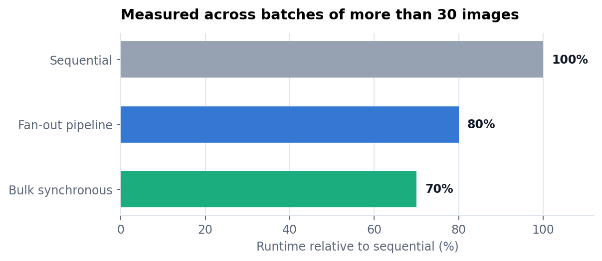
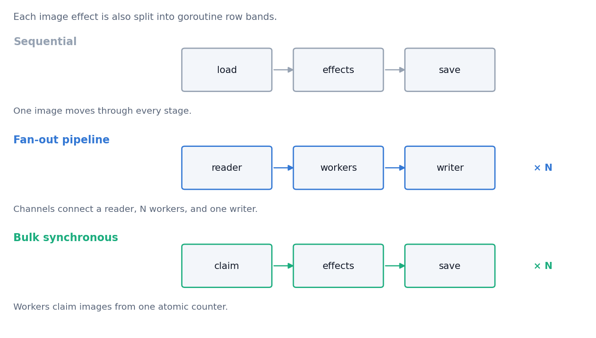

# Parallel Image Processing Engine

This project applies grayscale, blur, sharpen, and edge-detection effects to
PNG images through three execution models written in Go: sequential, fan-out
pipeline, and bulk synchronous parallel.

The original benchmark processed batches of more than 30 images. The fan-out
pipeline reduced runtime by 20%, while the bulk synchronous model reduced it by
30%, relative to sequential execution on the same workload.

<picture>
  <source media="(prefers-color-scheme: dark)" srcset="docs/runtime-dark.png">
  
</picture>

The chart reports relative runtime because the benchmark record preserves the
measured reductions but not the original machine specification or raw timing
table.

## Execution models

<picture>
  <source media="(prefers-color-scheme: dark)" srcset="docs/execution-models-dark.png">
  
</picture>

### Sequential

The sequential implementation loads one image, applies every requested effect,
saves the result, and then moves to the next image.

### Fan-out pipeline

One goroutine reads image tasks and sends them through a channel. A configurable
worker pool applies the effects, and a result channel feeds one writer. The
writer closes only after every worker has reported completion.

### Bulk synchronous parallel

The bulk synchronous implementation loads all image tasks first. Workers claim
the next task through one atomic counter, apply its effects, and stop at a shared
barrier before the outputs are saved.

Every parallel image worker also splits an effect into row bands. This adds a
second level of concurrency below the image-task workers.

## Image effects

The engine supports four effect codes:

| Code | Effect | Implementation |
|---|---|---|
| `G` | Grayscale | This averages the red, green, and blue channels. |
| `E` | Edge detection | This applies a 3×3 Laplacian kernel. |
| `S` | Sharpening | This applies a 3×3 centre-weighted sharpening kernel. |
| `B` | Blur | This applies a 3×3 box-blur kernel. |

`png/effects.go` evaluates the convolution kernels directly. Row-band workers
write disjoint output rows while still reading neighbouring pixels across band
boundaries, so a worker boundary does not become an artificial image edge.

## Run the included example

The repository includes one PNG fixture and four tasks in `data/effects.txt`.
Run commands from the `editor` directory because the program resolves `data/`
relative to that directory.

Sequential execution:

```bash
cd editor
go run . small
```

Fan-out pipeline with four workers:

```bash
go run . small pipeline 4
```

Bulk synchronous execution with four workers:

```bash
go run . small bsp 4
```

The generated files are written to `data/out/` with the data-directory prefix,
such as `small_test_img_edge.png`.

## Add a workload

Input images belong under one of these directories:

```text
data/in/small/
data/in/mixture/
data/in/big/
```

Each line in `data/effects.txt` is one JSON task:

```json
{"inPath":"test_img.png","outPath":"test_img_edge.png","effects":["E"]}
```

Multiple directories can share the same task list by joining their names with a
plus sign:

```bash
go run . small+big pipeline 8
```

The task list is decoded once and then reused for every selected directory.

## Correctness details

- The bulk synchronous worker claim uses `atomic.AddInt64`, so concurrent
  workers cannot read the same counter value and process one task twice.
- Convolution workers validate neighbours against the complete image bounds,
  not the current row band. This prevents seams at worker boundaries.
- The command-line parser checks its argument count before indexing `os.Args`.
- Invalid modes and unreadable task files fail explicitly instead of producing
  no output.

## Repository layout

| Path | Purpose |
|---|---|
| `editor/editor.go` | This file parses the command line and selects an execution model. |
| `implementations/sequential.go` | This file contains the single-threaded image loop. |
| `implementations/fanInFanOut.go` | This file contains the channel-based reader, worker pool, and writer. |
| `implementations/bulkSynchronousParallel.go` | This file contains the atomic task scheduler and barrier. |
| `png/effects.go` | This file contains grayscale processing and the 3×3 convolution kernels. |
| `png/png.go` | This file loads, stores, clamps, and saves 16-bit RGBA images. |
| `data/` | This directory contains the example input, task list, and generated outputs. |
