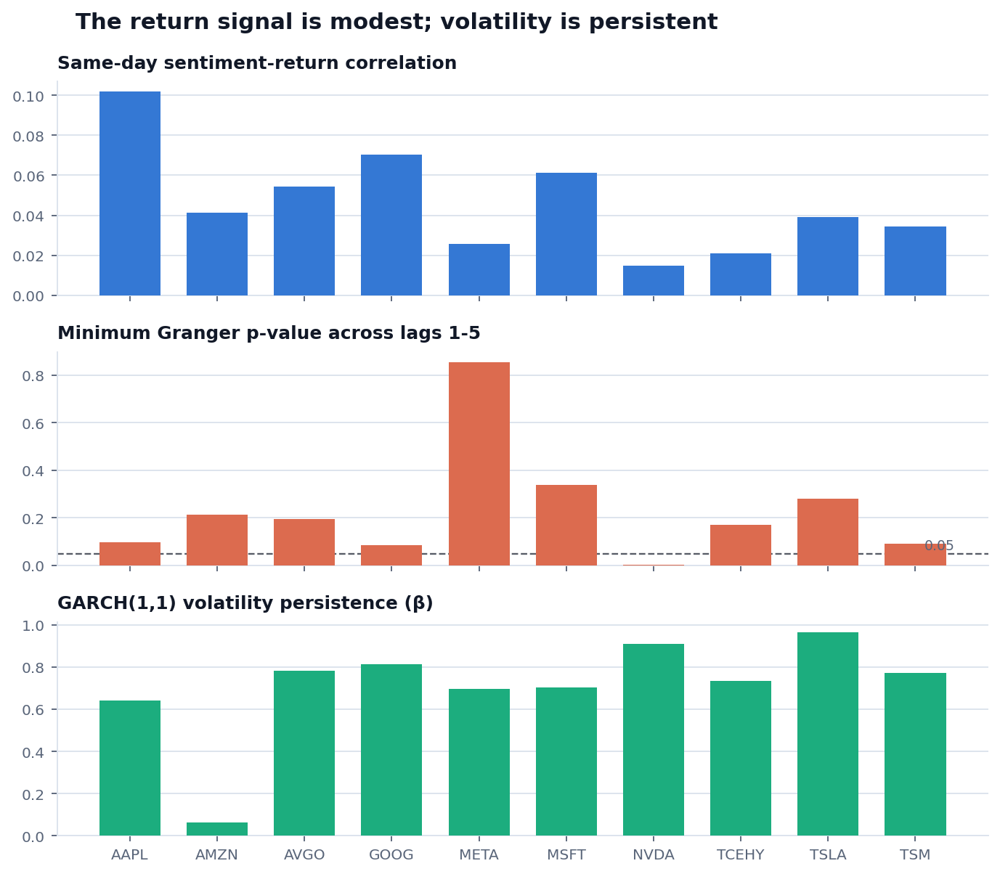
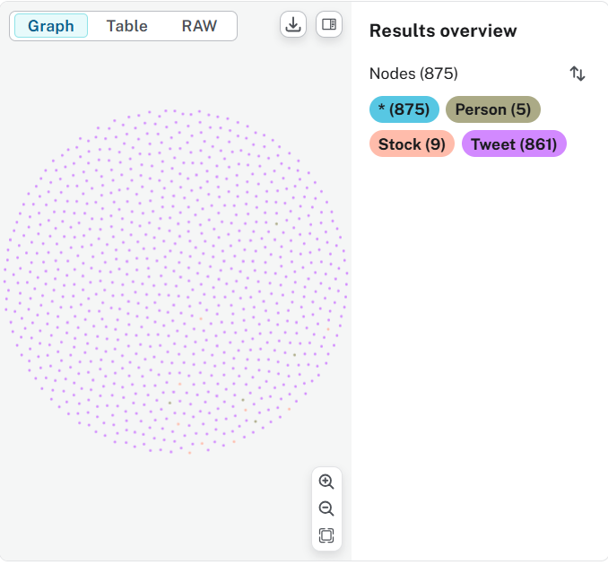
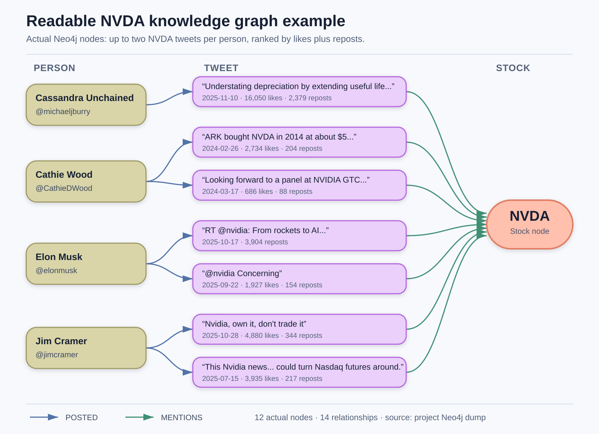
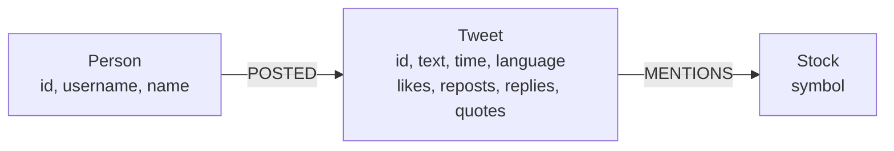
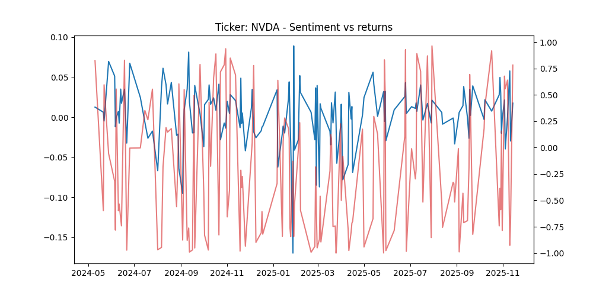

# Stock Sentiment Analysis

This project tests whether posts from six financial influencers line up with
daily returns for ten large technology stocks. It combines X API data, market
prices, FinTwitBERT sentiment scores, SQLite, Neo4j, Granger causality tests,
and GARCH(1,1) volatility models in one reproducible pipeline.

The work was completed by a team of four for Algorithms and Data Models at the
University of Victoria. The dataset contains 15,194 collected tweets, of which
861 mention at least one tracked stock.

## What the data showed

The measured effect was modest. AAPL had the largest same-day
sentiment-return correlation at 0.1018. NVDA was the only stock whose minimum
Granger p-value across lags 1-5 fell below 0.05, at 0.0036. The GARCH models
independently showed persistent return volatility for NVDA and TSLA, with beta
values of 0.9081 and 0.9627.

<picture>
  <source media="(prefers-color-scheme: dark)" srcset="docs/results-summary-dark.png">
  
</picture>

The three panels answer different questions:

- The first panel measures association between sentiment and same-day returns.
- The second tests whether lagged sentiment improves return forecasts beyond
  lagged returns. The dashed line marks the 0.05 significance threshold.
- The third measures persistence in the return series through GARCH(1,1). The
  GARCH model does not include sentiment in its variance equation.

The conclusion is intentionally narrow: influencer sentiment was not a strong
standalone predictor in this sample, and the one significant NVDA result should
be interpreted alongside the limited stock-specific tweet counts.

## Pipeline

`main.py` runs the analysis in four stages:

1. It scores cleaned English-language tweets with FinTwitBERT.
2. It aggregates sentiment by stock and day with engagement weights.
3. It joins the daily signal to market returns from the two SQLite price stores.
4. It runs stationarity, correlation, Granger, and GARCH analyses for each stock.

The final table is written to `result/final_analysis.csv`. The plotting code
writes one sentiment-return chart per ticker and a three-panel results summary.

## Data collection and storage

Tweets were collected from Elon Musk, Donald Trump, Cathie Wood, Jim Cramer,
Michael Burry, and Ray Dalio. A tweet is retained only when its text matches at
least one tracked company or ticker.

Daily OHLCV data comes from `yfinance` for these stocks:

- NVIDIA is tracked as `NVDA`.
- Apple is tracked as `AAPL`.
- Microsoft is tracked as `MSFT`.
- Alphabet is tracked as `GOOG`.
- Amazon is tracked as `AMZN`.
- Broadcom is tracked as `AVGO`.
- Meta Platforms is tracked as `META`.
- Taiwan Semiconductor is tracked as `TSM`.
- Tesla is tracked as `TSLA`.
- Tencent is tracked as `TCEHY`.

SQLite stores the records used for date joins and statistical analysis. Neo4j
stores the same collection as a knowledge graph so the project can preserve
who posted each message and which stocks that message connects to.

## Knowledge graph

The following image is the Neo4j Browser visualization generated from the
project's collected data. It is the full graph rather than a conceptual schema.



The displayed result contains 875 nodes: 861 tweets, five people, and nine
stocks. Although the collection configuration names six influencers and ten
stocks, Neo4j only creates nodes for people and stocks connected to a retained
stock-matching tweet. The full view is therefore dominated by the 861 purple
tweet nodes, with the smaller person and stock groups connected through
`POSTED` and `MENTIONS` relationships. At this scale the visualization shows
the graph's density and coverage; stock-specific Cypher queries provide a more
readable subgraph for individual relationships.

### Readable example: NVDA subgraph

The following view uses the original Neo4j dump and keeps up to two NVDA tweets
per person, ranked by likes plus reposts. It reduces the result to four people,
seven tweets, one stock, and fourteen relationships so every connection remains
visible.



Blue `POSTED` edges connect each person to their tweets. Green `MENTIONS` edges
connect those tweets to NVDA. The tweet labels show shortened text only for
readability; their dates and engagement counts come directly from the stored
Neo4j properties.

This Cypher query reproduces the selected subgraph:

```cypher
MATCH (person:Person)-[:POSTED]->(tweet:Tweet)-[:MENTIONS]->(stock:Stock {symbol: "NVDA"})
WITH person, tweet, stock,
     coalesce(tweet.like_count, 0) + coalesce(tweet.retweet_count, 0) AS engagement
ORDER BY person.username, engagement DESC
WITH person, stock, collect(tweet)[0..2] AS tweets
UNWIND tweets AS tweet
MATCH (person)-[posted:POSTED]->(tweet)-[mentions:MENTIONS]->(stock)
RETURN person, posted, tweet, mentions, stock;
```

The graph has three node types and two directed relationships:



A tweet can connect to more than one stock, while every tweet remains linked
to its original author. Unique constraints on person IDs, tweet IDs, and stock
symbols prevent repeated collection runs from creating duplicate nodes.

The two databases serve different purposes:

| Store | Role in the project |
|---|---|
| SQLite | Supplies the tabular records used to aggregate daily sentiment, join it to dated market prices, and run the statistical tests. |
| Neo4j | Preserves author-to-post-to-stock relationships for provenance and exploratory graph queries that would otherwise require repeated table joins. |

For example, the graph can rank the most-mentioned stocks, count how often each
influencer discussed a company, or find posts that connected several tracked
stocks:

```cypher
MATCH (person:Person)-[:POSTED]->(:Tweet)-[:MENTIONS]->(stock:Stock)
RETURN person.username, stock.symbol, count(*) AS posts
ORDER BY posts DESC;
```

```cypher
MATCH (tweet:Tweet)-[:MENTIONS]->(stock:Stock)
WITH tweet, collect(stock.symbol) AS symbols
WHERE size(symbols) > 1
RETURN tweet.id, symbols;
```

The current Granger and GARCH pipeline reads from SQLite; the knowledge graph
is a relationship and provenance layer rather than an input to those models.
The repository includes a Neo4j dump but does not commit API credentials or
local SQLite databases. Credentials belong in a local `.env` file.

## Sentiment signal

`sentiment_utils.py` removes URLs and mentions, drops non-English tweets, and
scores the remaining text with `StephanAkkerman/FinTwitBERT-sentiment`.

Each tweet receives this scalar score:

```text
sentiment = P(positive) - P(negative)
```

The daily stock-level signal is an engagement-weighted average. The weight for
one tweet is:

```text
weight = 1 + retweets + 0.5 × likes
```

This gives widely seen posts more influence without treating engagement as a
separate prediction target.

## Statistical analysis

The pipeline performs four checks for each stock:

1. Augmented Dickey-Fuller tests assess stationarity for returns and sentiment.
2. Pearson correlation measures the same-day linear association.
3. Granger tests examine lags 1-5 and record the smallest p-value.
4. GARCH(1,1) estimates how quickly return-volatility shocks decay.

The stored NVDA chart shows the two daily series used by the correlation and
Granger steps.



The individual series are noisy, which is why the project reports formal tests
instead of drawing a conclusion from visual overlap alone.

## Run the project

Install the dependencies:

```bash
pip install -r requirements.txt
```

Copy the environment template and add local credentials:

```bash
cp .env.example .env
```

Create the two market-price databases:

```bash
python downloading_data_training.py
python downloading_data_testing.py
```

Collect tweets into SQLite and Neo4j:

```bash
python collect_x_stock_tweets.py
```

Run the complete analysis:

```bash
python main.py
```

The collection step requires an X API bearer token and a running Neo4j
database. The statistical pipeline also requires the generated SQLite files.

## Repository layout

| Path | Purpose |
|---|---|
| `collect_x_stock_tweets.py` | This script collects tweets and writes the SQLite and Neo4j stores. |
| `downloading_data_training.py` | This script downloads the 2024 market-price partition. |
| `downloading_data_testing.py` | This script downloads the 2025 market-price partition. |
| `sentiment_utils.py` | This module cleans and scores tweets, then builds daily sentiment. |
| `stock_utils.py` | This module joins daily sentiment to stock returns. |
| `analysis_utils.py` | This module runs the stationarity, correlation, Granger, and GARCH tests. |
| `plotting_utils.py` | This module writes the per-stock and summary figures. |
| `report/` | This directory contains the full report and presentation. |

## Report and presentation

The full methodology, result tables, limitations, and team attribution are in
the [project report](report/Stock_Sentiment_Report.pdf). The condensed version
is available in the [presentation slides](report/Stock_Sentiment_Presentation.pdf).
